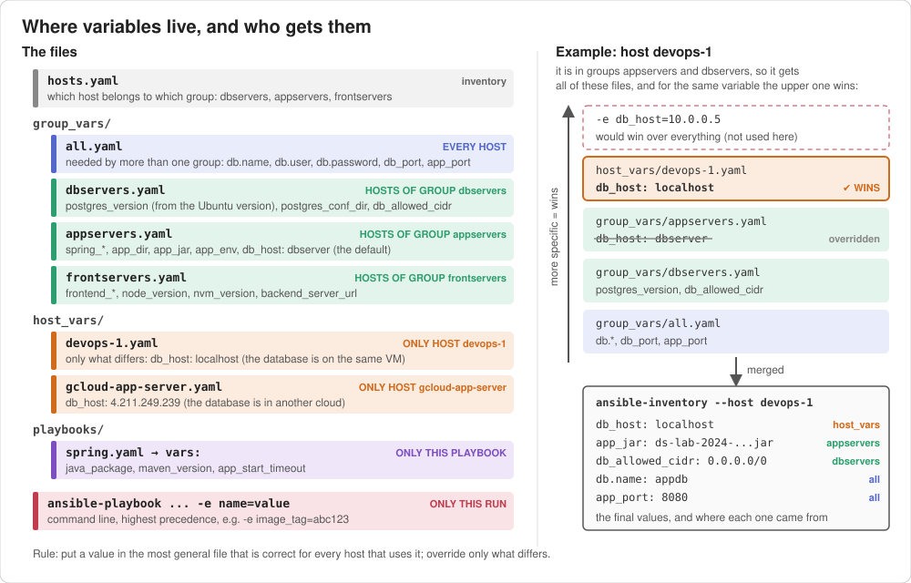

# Ansible DevOps

Ansible project for the DevOps course: it deploys a **PostgreSQL** database, a **Spring Boot** backend and a **Vue.js** frontend
on Vagrant VMs or cloud VMs. The step-by-step guide for building such a project from scratch (in Greek) is in [ansible_project_setup.md](ansible_project_setup.md).

## Contents
1. [Project structure](#project-structure)
2. [Inventory](#inventory)
3. [Development environment with Vagrant](#development-environment-with-vagrant)
4. [Running the playbooks](#running-the-playbooks)
5. [Where to put variables](#where-to-put-variables)
6. [Inspect inventory and variables](#inspect-inventory-and-variables)
7. [Vault](#vault)
8. [Roles](#roles)
9. [Kubernetes](#kubernetes)
10. [Links](#links)

## Project structure
```
.
├── ansible.cfg           # defaults: inventory, roles_path, ssh settings
├── hosts.yaml            # inventory: groups dbservers, appservers, frontservers, ...
├── group_vars/           # variables per group (all.yaml = every host)
├── host_vars/            # variables of one host, only what differs
├── playbooks/            # the playbooks
│   ├── tasks/            #   task lists shared by playbooks (import_tasks / include_tasks)
│   └── vars/             #   vars files (vault-example.yaml is encrypted)
├── files/                # templates (*.j2) and static files used by the playbooks
├── requirements.yml      # roles and collections from Ansible Galaxy
├── docs/                 # pictures used in this README
└── vagrant/              # Vagrantfile for the local VMs
```

## Inventory
* create an inventory file (e.g. hosts or hosts.yaml) that holds the remote hosts that ansible will handle.
* example entry:
```yaml
webserver: # <-- group
  hosts: # <-- List of hosts in group
    gcloud_host: # <-- host number 1 in group
      ansible_host: 35.189.109.16
      ansible_port: 22
      ansible_ssh_user: rg
    app01:  # <-- host number 2 in group
      ansible_host: app01
    app02:  # <-- host number 3 in group
      ansible_host: app02
  vars:  # <-- common variables in this group
    ansible_python_interpreter: /usr/bin/python3
```
* to test if all hosts are accessible, run
```bash
ansible -m ping all
```
* to test if a group of hosts are accessible, run
```bash
ansible -m ping <group-name>
```

### Ignore host_key_checking
Add this line to `ansible.cfg` in the `[defaults]` section (already done in this project), so that ssh does not ask "Are you sure you want to continue connecting?" for VMs that are created again and again:
```ini
host_key_checking = false
```
Links:
* [Managing host key checking](https://docs.ansible.com/ansible/latest/user_guide/connection_details.html)

## Development environment with Vagrant
* run testing environment
```bash
vagrant plugin install vagrant-hostmanager
vagrant plugin install vagrant-libvirt   # only for the libvirt provider (Linux)
cd vagrant
vagrant up control   # first: creates the ssh key the other VMs need
vagrant up
vagrant ssh-config >> ~/.ssh/config
```

### libvirt provider
The `Vagrantfile` uses **libvirt** (KVM) as the default provider instead of VirtualBox.
* host requirements: `libvirt`, `qemu`, `virtiofsd` (for the shared `/vagrant` folder) and the `vagrant-libvirt` plugin
* the VMs live in `qemu:///system`. To see them graphically use `virt-manager` (connect to *QEMU/KVM*, not *User session*), or from the CLI:
```bash
virsh -c qemu:///system list --all
```

### VirtualBox provider (alternative)
If you prefer VirtualBox (e.g. on Windows / macOS, or if you already use it), the same `Vagrantfile` works:
* install [VirtualBox](https://www.virtualbox.org/wiki/Downloads) (no extra Vagrant plugin is needed)
* pass the provider when creating the VMs:
```bash
cd vagrant
vagrant up control --provider=virtualbox
vagrant up --provider=virtualbox
```
or set it once for your shell, so that every `vagrant` command uses it:
```bash
export VAGRANT_DEFAULT_PROVIDER=virtualbox    # Windows PowerShell: $env:VAGRANT_DEFAULT_PROVIDER="virtualbox"
```
* the provider is chosen when a VM is created. To switch provider, first destroy the existing VMs with `vagrant destroy -f`
* VirtualBox and libvirt/KVM cannot run VMs at the same time on the same host

### "Network is unreachable" inside the VMs (Docker + libvirt)
If Docker runs on the host, it sets the iptables `FORWARD` policy to `DROP`, which also blocks traffic from the libvirt bridges (`virbr*`). The VMs then have no internet access and may not be able to reach each other.
* check:
```bash
sudo iptables -S FORWARD | head -3    # "-P FORWARD DROP" means this is the problem
```
* permanent fix (Docker >= 28): tell Docker not to change the policy
```bash
sudo mkdir -p /etc/docker
echo '{ "ip-forward-no-drop": true }' | sudo tee /etc/docker/daemon.json
sudo systemctl restart docker
sudo iptables -P FORWARD ACCEPT       # resets the DROP policy that is already active
```
* quick fix until the next reboot (alternative):
```bash
sudo iptables -I DOCKER-USER -i virbr+ -j ACCEPT
sudo iptables -I DOCKER-USER -o virbr+ -j ACCEPT
```
* verify from inside a VM:
```bash
vagrant ssh control -c 'ping -c2 8.8.8.8'
```

Links:
* [Vagrant Quick start](https://learn.hashicorp.com/collections/vagrant/getting-started)

## Running the playbooks
| Playbook | `hosts:` | What it does |
|---|---|---|
| `postgres.yaml` | dbservers | PostgreSQL, application database and user |
| `postgres-16.yaml` | dbservers | the same with `lineinfile` and `block`/`rescue` |
| `postgres-from-role.yaml` | dbservers | the same with the Galaxy role `geerlingguy.postgresql` (see [Roles](#roles)) |
| `spring.yaml` | appservers | Spring Boot backend as a systemd service, behind nginx |
| `vuejs.yaml` | frontservers | Vue.js frontend, built and served by nginx |
| `spring-vue-docker.yaml` | appservers | the whole stack with docker compose |
| `docker.yaml` | all | Docker engine and compose plugin |
| `nginx.yaml` | all | nginx with a static html page |
| `hostvars_and_facts.yml` | all | print the variables and facts of a host |
| `vault-example.yaml` | localhost | ansible-vault example (see [Vault](#vault)) |
| `k8s-update-spring-deployment.yaml` | localhost | update the image of a Kubernetes deployment |

* run a playbook
```bash
ansible-playbook -l dbserver-vm playbooks/postgres.yaml
```
* full stack on the Vagrant VMs (database -> spring backend -> vue frontend)
```bash
ansible-playbook -l dbserver-vm  playbooks/postgres.yaml    # group dbservers
ansible-playbook -l appserver-vm playbooks/spring.yaml      # group appservers
ansible-playbook -l frontend-vm  playbooks/vuejs.yaml       # group frontservers
```
Each playbook targets its own group (`hosts:`), so `-l` only limits the run to the Vagrant VMs and leaves out the cloud hosts of the same group.

## Where to put variables
The same value can be written in many places. We follow a few simple rules, so that every value is defined **once**, in the place where it is easiest to find and change.



How to read the picture:
* **Left: the files.** The color shows **who gets** the variables of each file:
  every host (`group_vars/all.yaml`), the hosts of one group (`group_vars/<group>.yaml`),
  one host (`host_vars/<host>.yaml`), one playbook (`vars:`) or one run (`-e`).
  The file name is what connects it to the hosts: `group_vars/appservers.yaml` is read for every host of the group `appservers` in `hosts.yaml`.
* **Right: one host.** `devops-1` is in two groups, so Ansible reads `all.yaml`, `appservers.yaml`, `dbservers.yaml` **and** `host_vars/devops-1.yaml`, and merges them.
  When the same variable is in more than one file, the **more specific** one wins: `db_host` is `dbserver` for all appservers, but `localhost` for `devops-1`.
* **Bottom right: the result**, which you can see yourself with `ansible-inventory --host devops-1` (see [Inspect inventory and variables](#inspect-inventory-and-variables)).

### The main idea
1. **Group hosts by role**, not by provider or location: `dbservers`, `appservers`, `frontservers`.
   A playbook targets a role (`hosts: appservers`) and `-l` only limits the run to some hosts of it.
   A host can have more than one role (e.g. `devops-1` is in `appservers` and `dbservers`), and then it gets the variables of both groups.
2. **Put a value as "high" as possible**: in the most general place that is correct for every host that uses it.
3. **Override only what differs**, as low as needed (in `host_vars`), and nothing more.
4. **Don't write what Ansible can find out**: values that depend on the OS, the architecture, the user etc. are computed from facts.
5. **Every value that appears twice, or that someone may want to change** (versions, paths, URLs, ports, repositories), becomes a variable.

### Which file? Ask these questions in order
| Question | If yes, put it in | Example in this project |
|---|---|---|
| Does it change on every run (e.g. a build number)? | `-e name=value` on the command line | `-e image_tag=abc123` (k8s playbook) |
| Is it a secret? | a file encrypted with `ansible-vault` (see [Vault](#vault)) | `db.password` in a real project |
| Can it be computed from facts? | a variable with a Jinja expression, or directly `ansible_facts` | `postgres_version`, docker `distribution_release` / `architecture` |
| Is it used only by one playbook and is the same on every host? | `vars:` of the play | `java_package`, `maven_version` in `spring.yaml` |
| Is it needed by **more than one group**? | `group_vars/all.yaml` | `db.*` (the db server creates the database, the app server connects to it), `app_port` (spring listens on it, the frontend nginx proxies to it) |
| Is it the same for **all hosts of one group**? | `group_vars/<group>.yaml` | `app_dir`, `app_jar` (appservers), `node_version` (frontservers), `db_allowed_cidr` (dbservers) |
| Is it different for **one host**? | `host_vars/<host>.yaml`, only that value | `db_host: localhost` for `devops-1` |

Rule of thumb: if you are about to copy the same line into a second `host_vars` file, it probably belongs in `group_vars`.
If you are about to copy it into a second `group_vars` file, it belongs in `group_vars/all.yaml`.

### Precedence: who wins
When the same variable is defined in more than one place, the more **specific** one wins (simplified, from low to high):
```
group_vars/all  <  group_vars/<group>  <  host_vars/<host>  <  play vars:  <  set_fact / register  <  -e
```
This is why defaults go in `group_vars` and exceptions in `host_vars`: e.g. `db_host` is `dbserver` for all appservers, but `localhost` for `devops-1`.
Check the final value with `ansible-inventory --host <host>` (see below).

### Dictionaries: build them from simple variables
A dictionary defined again in `host_vars` **replaces** the whole dictionary from `group_vars` (it is not merged).
So we do not override dictionaries; we build them from simple variables and override those:
```yaml
# group_vars/appservers.yaml
db_host: dbserver
app_env:
  server.port: "{{ app_port }}"
  spring.datasource.url: "jdbc:postgresql://{{ db_host }}:{{ db_port }}/{{ db.name }}"
```
```yaml
# host_vars/devops-1.yaml: one line, the rest of app_env stays as is
db_host: localhost
```

### Values computed from facts
Variables are evaluated when they are **used**, not when the file is read. So a variable can depend on facts of the host:
```yaml
# group_vars/dbservers.yaml
postgres_versions:
  "22.04": 14
  "24.04": 16
postgres_version: "{{ postgres_versions[ansible_facts['distribution_version']] }}"
postgres_conf_dir: "/etc/postgresql/{{ postgres_version }}/main"
```
The same playbook then works on Ubuntu 22.04 and 24.04, without `when:` and without hardcoded paths.
Such variables need facts (`gather_facts`, enabled by default). That is also why `ansible-inventory` shows them unrendered.

### Naming
* prefix the variable with the component it belongs to: `frontend_branch`, `frontend_dir`, `db_host`, `postgres_version`
* avoid generic names in shared files (`branch`, `dir`, `version`): a play `vars: branch: main` would silently hide the `branch: api` of `group_vars`. That is why the two branches are called `spring_branch` and `frontend_branch`.
* use the same name for the same thing everywhere (`app_port` in the spring config, in the nginx template and in `wait_for`)

### Where each variable is defined in this project
| File | Applies to | Contains |
|---|---|---|
| `group_vars/all.yaml` | every host | `db.*`, `db_port`, `app_port` (needed by more than one group) |
| `group_vars/dbservers.yaml` | `dbservers` | `postgres_version` (from the Ubuntu version), `postgres_conf_dir`, `db_allowed_cidr` |
| `group_vars/appservers.yaml` | `appservers` | spring backend: `spring_repo_url`, `spring_branch`, `app_dir`, `app_jar`, `db_host`, `app_env`, `spring_service` |
| `group_vars/frontservers.yaml` | `frontservers` | vue frontend: `frontend_*`, `node_version`, `nvm_version`, `backend_host`, `backend_server_url` |
| `host_vars/<host>.yaml` | one host | only what differs, e.g. `db_host` |
| `vars:` in a playbook | that play | values used only by that playbook, e.g. `java_package` in `spring.yaml` |
| `-e name=value` | that run | highest precedence, e.g. `-e image_tag=abc123` |

## Inspect inventory and variables
Before running a playbook it is useful to check **which hosts** it will run on and **which values** the variables will have.
Variables come from many places (`hosts.yaml`, `group_vars/`, `host_vars/`, play `vars:`, `-e`), so it is easy to end up with a value you did not expect.

### `ansible-inventory --host`: all variables of one host
```bash
ansible-inventory --host devops-1
```
Prints, as JSON, the **final** variables of the host after merging `hosts.yaml`, `group_vars/all.yaml`, `group_vars/<group>.yaml` for every group the host belongs to, and `host_vars/<host>.yaml`:
```json
{
    "ansible_host": "devops-vm-1",
    "app_env": {
        "server.port": "{{ app_port }}",
        "spring.datasource.url": "jdbc:postgresql://{{ db_host }}:{{ db_port }}/{{ db.name }}",
        ...
    },
    "app_port": 8080,
    "app_dir": "{{ ansible_user_dir }}/spring",
    "spring_branch": "api",
    "db": { "name": "appdb", "user": "appuser", ... },   <-- group_vars/all.yaml
    "db_host": "localhost",                              <-- host_vars/devops-1.yaml
    "postgres_version": "{{ postgres_versions[ansible_facts['distribution_version']] }}",
    ...
}
```
What to look for:
* a variable that is **missing**: the playbook will fail with `'...' is undefined`
* a variable with an **unexpected value**, e.g. which file "won". Here `db_host` is `dbserver` in `group_vars/appservers.yaml`, but `localhost` for `devops-1` because `host_vars` has higher precedence.
* a **dictionary** in `host_vars` **replaces** the whole dictionary with the same name from `group_vars`, it is not merged. That is why `app_env` is built from simple variables (`db_host`, `app_port`, `db.*`) and the `host_vars` files only change those.
* Jinja expressions (`{{ ... }}`) are shown **unrendered**. They are evaluated only when a play runs, and the ones that use facts (e.g. `ansible_user_dir`, `ansible_facts`) need a connection to the host.

### Other useful commands
* tree of groups and hosts (which host belongs to which group)
```bash
ansible-inventory --graph
```
* the same tree including the variables of each host
```bash
ansible-inventory --graph --vars appservers
```
* the whole inventory (all groups, hosts and variables) as JSON or YAML
```bash
ansible-inventory --list
ansible-inventory --list --yaml
```
* the **rendered** value of a variable (Jinja is evaluated, e.g. `{{ app_port }}` becomes `8080`)
```bash
ansible devops-1 -m debug -a "var=app_env"
ansible appservers -m debug -a "var=app_env"   # for every host of the group
```
Ad-hoc commands do **not** gather facts, so variables that depend on facts show an error, e.g. `spring_service` uses `app_dir`, which uses `ansible_user_dir`:
`"workingdir": "<< error 1 - 'ansible_user_dir' is undefined >>/spring"`.
For those, use a playbook (facts are gathered by default), e.g. `ansible-playbook -l appserver-vm playbooks/hostvars_and_facts.yml`.
* which hosts a playbook will run on (respecting `hosts:` and `-l`), without running it
```bash
ansible-playbook playbooks/spring.yaml --list-hosts
ansible-playbook playbooks/spring.yaml --list-hosts -l devops-1
```
* which tasks (and tags) a playbook contains
```bash
ansible-playbook playbooks/spring.yaml --list-tasks
ansible-playbook playbooks/spring.yaml --list-tags
```
* check the playbook syntax (YAML, module names, indentation)
```bash
ansible-playbook playbooks/spring.yaml --syntax-check
```
* dry run: show what **would** change without changing anything (`--diff` also shows the changes in files and templates)
```bash
ansible-playbook -l devops-1 playbooks/spring.yaml --check --diff
```
Tasks that use `command`/`shell` are skipped in check mode, so tasks that depend on their results may fail.
* the facts the host reports (OS, IPs, users, ...), filtered by name
```bash
ansible devops-1 -m setup -a "filter=ansible_distribution*"
ansible devops-1 -m setup -a "filter=ansible_default_ipv4"
```
* the settings of `ansible.cfg` that differ from the defaults
```bash
ansible-config dump --only-changed
```
* more output while a playbook runs, e.g. the variables of each task or the ssh connection (`-v` up to `-vvvv`)
```bash
ansible-playbook -l devops-1 playbooks/spring.yaml -vv
```

### Get host basic info
```bash
ansible-playbook -l <hostname> playbooks/hostvars_and_facts.yml
```

## Vault
`ansible-vault` encrypts secrets (passwords, api keys, private keys) so that they can be **committed to git** together with the rest of the project.
Only who has the **vault password** can decrypt them. Ansible decrypts them automatically while a playbook runs.

### Try it: `playbooks/vault-example.yaml`
A small playbook that runs locally (no VM needed) and uses both ways of encrypting. The vault password of the example is `devops`.
```bash
ansible-playbook playbooks/vault-example.yaml --ask-vault-pass
```
```
ok: [localhost] => {
    "msg": "user=$REDACTED$, api_key has 18 characters, api_token has 17 characters"
}
```
* without the password it fails: `Attempting to decrypt but no vault secrets found`
* recent ansible-core versions (e.g. 2.22) print values that come from the vault as `$REDACTED$`

### 1. Encrypt a whole file
Good for a file that holds only secrets (e.g. `playbooks/vars/vault-example.yaml`).
```bash
ansible-vault create playbooks/vars/secrets.yaml     # new file, opens the editor
ansible-vault encrypt playbooks/vars/secrets.yaml    # existing plain file -> encrypted
ansible-vault view playbooks/vars/secrets.yaml       # print the decrypted content
ansible-vault edit playbooks/vars/secrets.yaml       # decrypt, open the editor, encrypt again on save
ansible-vault decrypt playbooks/vars/secrets.yaml    # back to plain text (be careful not to commit it)
ansible-vault rekey playbooks/vars/secrets.yaml      # change the vault password
```
The encrypted file looks like this, so `git diff` and `grep` cannot show what changed:
```
$ANSIBLE_VAULT;1.1;AES256
34656363656537346337333631313365613363643765623464366364316532306561616337386363
...
```
Use it from a playbook with `vars_files:`, or put it in `group_vars/` / `host_vars/` (see below).

### 2. Encrypt only one value
Good when the rest of the file should stay readable.
```bash
ansible-vault encrypt_string 'inline-secret-456' --name vault_inline_token
```
Paste the output in any vars file or `vars:` section:
```yaml
vault_inline_token: !vault |
          $ANSIBLE_VAULT;1.1;AES256
          3761343539666561...
```
To see the value again, give the `$ANSIBLE_VAULT...` lines, without the indentation, to `ansible-vault decrypt`
(`debug` does not help here, it prints `$REDACTED$`):
```bash
sed -n '/\$ANSIBLE_VAULT/,$p' file-with-only-this-variable.yaml | tr -d ' ' | ansible-vault decrypt
```

### How to give the vault password
| Way | Command / setting | When |
|---|---|---|
| ask every time | `--ask-vault-pass` (or `-J`) | interactive use |
| file | `--vault-password-file ~/.ansible/vault_pass.txt` | to avoid typing it |
| file, always | `vault_password_file = ~/.ansible/vault_pass.txt` in `[defaults]` of `ansible.cfg` | every run needs it |
| file, from the environment | `export ANSIBLE_VAULT_PASSWORD_FILE=~/.ansible/vault_pass.txt` | CI/CD (Jenkins, GitHub Actions) |

The password file holds only the password, it is readable only by you and it is **never** committed:
```bash
echo 'devops' > ~/.ansible/vault_pass.txt
chmod 600 ~/.ansible/vault_pass.txt
```
If the password is lost, the encrypted data cannot be recovered.

### Pattern: secrets in `group_vars` with the `vault_` prefix
This is the usual way to keep secrets of the **inventory** (e.g. the database password) in git.

#### The problem
`group_vars/all.yaml` has the database password in plain text, next to normal values:
```yaml
db:
  name: appdb
  user: appuser
  password: apppassword      # <-- the only secret in the file
db_port: 5432
app_port: 8080
```
We want to encrypt only the password. Two obvious solutions both have a problem:
* **encrypt the whole file** (`ansible-vault encrypt group_vars/all.yaml`): now nobody can read `db_port` or `app_port` without the vault password, `grep app_port` finds nothing, and `git diff` shows only encrypted text for any change
* **encrypt only the value** with `encrypt_string`: it works, but a file full of `!vault |` blocks is hard to read, and every secret is changed with a separate command

#### The solution: two files, connected by a variable
Split the variables of the group in two files: one **plain** with all the variables, and one **encrypted** with only the secret values.
The plain file does not contain the secret; it **points** to it with a variable whose name starts with `vault_`:
```
group_vars/all/           # a directory instead of the file all.yaml
├── vars.yaml             # plain:     db.password: "{{ vault_db_password }}"
└── vault.yaml            # encrypted: vault_db_password: apppassword
```
```yaml
# group_vars/all/vars.yaml: plain, everyone can read it
db:
  name: appdb
  user: appuser
  password: "{{ vault_db_password }}"    # the value is in vault.yaml
db_port: 5432
app_port: 8080
```
```yaml
# group_vars/all/vault.yaml: encrypted, only the secrets, all named vault_*
vault_db_password: apppassword
```
How it works:
* **Ansible reads every file in `group_vars/all/`** (in alphabetical order) for the hosts of `all`, exactly as if they were one file. So `vault_db_password` and `db` are both available.
* **The playbooks do not change**: they still use `db.password`. When it is used, `"{{ vault_db_password }}"` is evaluated and gets the value from the encrypted file.
* **The `vault_` prefix is a convention, not an Ansible feature.** It tells the reader "this value is in the encrypted file".

#### Step by step, for this project
```bash
# 1. the file becomes a directory
mkdir group_vars/all
git mv group_vars/all.yaml group_vars/all/vars.yaml

# 2. in vars.yaml replace the secret value with a reference
#      password: apppassword   ->   password: "{{ vault_db_password }}"

# 3. create the encrypted file with the secret (opens the editor)
ansible-vault create group_vars/all/vault.yaml
#      vault_db_password: apppassword

# 4. check: the password is now needed to read the inventory at all
ansible-inventory --host devops-1                      # ERROR: no vault secrets found
ansible-inventory --host devops-1 --ask-vault-pass
ansible devops-1 -m debug -a 'msg="{{ db.password | length }} chars"' --ask-vault-pass
```
The same works for any group (`group_vars/dbservers/vars.yaml` + `vault.yaml`) or host (`host_vars/devops-1/vars.yaml` + `vault.yaml`).

#### What you get
* everybody can still read and `grep` every variable name: `grep -rn db_password group_vars` finds
  `group_vars/all/vars.yaml:  password: "{{ vault_db_password }}"`, and the `vault_` name tells where the value is
* `git diff` of `vars.yaml` stays readable; only changes in `vault.yaml` are encrypted
* the secrets are in one place: `ansible-vault edit group_vars/all/vault.yaml`, `ansible-vault rekey group_vars/all/vault.yaml`
* `ansible-inventory --host` shows `"password": "{{ vault_db_password }}"` and `"vault_db_password": "$REDACTED$"`, so the secret does not leak in the output

The cost: **every** command that loads the inventory needs the vault password, even `ansible -m ping`, because Ansible reads all of `group_vars/all/` before it runs anything.
That is why this project keeps `db.password` in plain text in `group_vars/all.yaml`: the playbooks run in the lab without a vault password.

### Keep secrets out of the output
* `no_log: true` on a task hides its arguments and result, also with `-v` (see the second task of `vault-example.yaml`)
* use it on tasks that print or register secrets, e.g. `uri` with an `Authorization` header, or `shell` with a password on the command line

### More than one password: vault IDs
E.g. a different password for development and production. The label is written in the encrypted data:
```bash
ansible-vault encrypt_string --vault-id prod@prompt 'S3cr3t' --name vault_db_password
#   $ANSIBLE_VAULT;1.2;AES256;prod
ansible-playbook site.yaml --vault-id dev@~/.ansible/dev_pass.txt --vault-id prod@prompt
```

Links:
* [Protecting sensitive data with Ansible Vault](https://docs.ansible.com/ansible/latest/vault_guide/index.html)
* [Organizing host and group variables (directories in group_vars)](https://docs.ansible.com/ansible/latest/inventory_guide/intro_inventory.html#organizing-host-and-group-variables)

## Roles
A **role** is a reusable package of tasks, together with the handlers, templates, files and default variables they need.
A playbook then only says **which roles run on which hosts**. Think of a role as a function and of its variables as the function arguments.

When to write a role:
* the same steps appear in more than one playbook (e.g. "install nginx, copy a site config, enable it, reload" is in `nginx.yaml`, `spring.yaml` and `vuejs.yaml`)
* you want to reuse it in other projects, or share it (Ansible Galaxy)
* a playbook became too long to read

### Structure
```bash
ansible-galaxy role init roles/nginx_site
```
```
roles/nginx_site/
├── defaults/main.yml   # variables with default values: the "arguments" of the role (lowest precedence)
├── vars/main.yml       # internal constants of the role (high precedence, not meant to be overridden)
├── tasks/main.yml      # the tasks, run in order
├── handlers/main.yml   # handlers, e.g. "reload nginx"
├── templates/          # Jinja2 templates: template: src=site.conf.j2 looks here
├── files/              # static files: copy: src=index.html looks here
├── meta/main.yml       # author, supported platforms, dependencies on other roles
├── README.md           # which variables the role expects
└── tests/              # a small inventory and playbook to try the role
```
Only `tasks/main.yml` is required; delete the folders you do not use.
Inside a role, `src:` of `template`/`copy` is found **relative to the role** (`templates/`, `files/`), not with `../files/` as in our playbooks.

### Example: the nginx part of the playbooks as a role
```yaml
# roles/nginx_site/defaults/main.yml: what the user of the role can change
nginx_site_name: default_site
nginx_site_template: site.conf.j2
```
```yaml
# roles/nginx_site/tasks/main.yml
- name: Install nginx
  ansible.builtin.apt:
    name: nginx
    state: present
    update_cache: true
    cache_valid_time: 3600

- name: Copy the site configuration
  ansible.builtin.template:
    src: "{{ nginx_site_template }}"
    dest: "/etc/nginx/sites-available/{{ nginx_site_name }}"
    mode: "0644"
  notify: reload nginx

- name: Enable the site
  ansible.builtin.file:
    src: "/etc/nginx/sites-available/{{ nginx_site_name }}"
    dest: "/etc/nginx/sites-enabled/{{ nginx_site_name }}"
    state: link
  notify: reload nginx

- name: Disable the default site
  ansible.builtin.file:
    path: /etc/nginx/sites-enabled/default
    state: absent
  notify: reload nginx
```
```yaml
# roles/nginx_site/handlers/main.yml
- name: reload nginx
  ansible.builtin.shell: nginx -t && systemctl reload nginx
```
The playbooks then only pass the arguments:
```yaml
- hosts: appservers
  become: true
  roles:
    - role: nginx_site
      vars:
        nginx_site_name: spring
        nginx_site_template: nginx.http.j2
```
Prefix the variables of a role with the role name (`nginx_site_*`), so they do not collide with the variables of the project or of other roles.

### Three ways to use a role in a playbook
| Way | When it runs | Use it for |
|---|---|---|
| `roles:` section | after `pre_tasks`, **before** `tasks` | the main work of the play |
| `ansible.builtin.import_role` (a task) | where you put it; **static**, loaded when the playbook is read | a role in the middle of other tasks; its tags/`--list-tasks` are visible |
| `ansible.builtin.include_role` (a task) | where you put it; **dynamic**, loaded when it is reached | a role with `when:` or `loop:` |
```yaml
tasks:
  - name: Configure the spring site
    ansible.builtin.include_role:
      name: nginx_site
    vars:
      nginx_site_name: spring
      nginx_site_template: nginx.http.j2
    when: "'appservers' in group_names"
```

### Variables of roles
* **`defaults/main.yml`** has the **lowest** precedence of all: anything in `group_vars`, `host_vars`, play `vars:` or `-e` overrides it. This is what makes a role reusable.
* **`vars/main.yml`** has high precedence (higher than inventory variables): use it only for values the user should not change.
* So the full order from [Precedence: who wins](#precedence-who-wins) starts with the role defaults:
```
role defaults  <  group_vars/all  <  group_vars/<group>  <  host_vars/<host>  <  play vars:  <  role vars  <  set_fact / register  <  -e
```
* To see which variables a Galaxy role expects, read its `README.md` and `defaults/main.yml`, e.g. `~/.ansible/roles/geerlingguy.postgresql/defaults/main.yml`.

### Roles from Ansible Galaxy
[Ansible Galaxy](https://galaxy.ansible.com) has ready-made roles, named `<namespace>.<role>`.
The project lists what it needs, roles **and** collections, in [requirements.yml](requirements.yml), with fixed versions:
```yaml
roles:
  - name: geerlingguy.postgresql
    version: "4.0.0"
collections:
  - name: community.postgresql
    version: ">=4.0.0"
```
```bash
ansible-galaxy install -r requirements.yml    # roles and collections
ansible-galaxy role list                      # installed roles and where
```
* roles are installed in the first path of `roles_path` in `ansible.cfg`, i.e. `./roles`
* `.gitignore` excludes `roles/*.*/` (Galaxy roles have a dot in their name), so only **our own** roles are committed; everyone else gets the Galaxy roles from `requirements.yml`
* tools such as Jenkins, AWX or Semaphore read `requirements.yml` and install the dependencies before running a playbook

Example: [playbooks/postgres-from-role.yaml](playbooks/postgres-from-role.yaml) installs PostgreSQL with `geerlingguy.postgresql`:
* the role is configured only through its variables (`postgresql_databases`, `postgresql_users`, `postgresql_hba_entries`) in play `vars:`
* the play adds one task of its own after the role and notifies the role handler `restart postgresql`
* compare it with [playbooks/postgres.yaml](playbooks/postgres.yaml), which does the same with plain tasks
```bash
ansible-playbook playbooks/postgres-from-role.yaml --list-tasks
#   geerlingguy.postgresql : Ensure PostgreSQL is started and enabled on boot.
```
In the output, every task of a role starts with the role name.

### Roles and collections
A **collection** is a bigger package: modules, plugins **and** roles, e.g. `community.postgresql` gives the `postgresql_db` module.
That is why we write modules with their full name (FQCN): `community.postgresql.postgresql_db`, `ansible.builtin.apt`.
Roles add tasks; collections add new modules. Both are listed in `requirements.yml`.

Links:
* [Roles](https://docs.ansible.com/ansible/latest/playbook_guide/playbooks_reuse_roles.html)
* [Installing roles and collections with requirements.yml](https://docs.ansible.com/ansible/latest/galaxy/user_guide.html#installing-roles-and-collections-from-the-same-requirements-yml-file)
* [ansible postgres role](https://galaxy.ansible.com/geerlingguy/postgresql)

## Kubernetes
Install the python kubernetes client, needed by the `kubernetes.core` modules (`playbooks/k8s-update-spring-deployment.yaml`):
```bash
sudo apt install python3-kubernetes
```

## Links
* [apt module](https://docs.ansible.com/ansible/latest/collections/ansible/builtin/apt_module.html)
* [file module](https://docs.ansible.com/ansible/latest/collections/ansible/builtin/file_module.html)
* [copy module](https://docs.ansible.com/ansible/latest/collections/ansible/builtin/copy_module.html)
* [service module](https://docs.ansible.com/ansible/latest/collections/ansible/builtin/service_module.html)
* [debconf module](https://docs.ansible.com/ansible/latest/collections/ansible/builtin/debconf_module.html)
* [ansible postgres role](https://galaxy.ansible.com/geerlingguy/postgresql)
